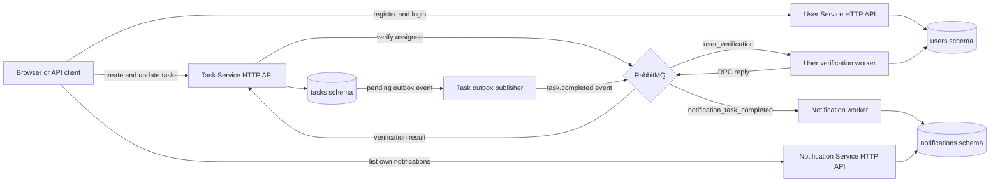

# TaskFlow service flow

This guide explains how the User, Task, and Notification services cooperate, which background processes support them, where data is stored, and how to run the complete local flow.

## System at a glance

TaskFlow has three business services. Each owns its own HTTP API and PostgreSQL schema.

| Component                | Main responsibility                                                                     | Data ownership                            |
| ------------------------ | --------------------------------------------------------------------------------------- | ----------------------------------------- |
| User Service             | Registration, login, refresh-token rotation, user lookup, and user-existence replies    | `users` schema                            |
| Task Service             | Task creation, assignment, status updates, authorization, and completion-event creation | `tasks` schema                            |
| Notification Service     | Persisting task-completion notifications and listing the signed-in user's notifications | `notifications` schema                    |
| User verification worker | Consumes user-existence requests on behalf of User Service                              | Reads `users` schema                      |
| Task outbox publisher    | Publishes pending completion events on behalf of Task Service                           | Reads and updates `tasks.outbox_messages` |
| Notification worker      | Consumes completion events on behalf of Notification Service                            | Writes `notifications` schema             |
| PostgreSQL               | Durable storage for each service's schema                                               | One database, separated schemas           |
| RabbitMQ                 | Carries request/reply messages and asynchronous events                                  | Broker queues and exchanges               |

The workers and outbox publisher are separate processes, not extra business services or HTTP APIs.



## HTTP APIs

### User Service

- `POST /users/register` creates a user with name, email, password, and role.
- `POST /users/login` checks credentials, creates a refresh session, and sets access and refresh JWT cookies.
- `POST /users/refresh` rotates a refresh session and returns fresh cookies.
- `GET /users/{id}` and `GET /users` return safe user projections to authenticated callers.
- The worker uses the same User Service application and persistence layer to check whether a user ID exists.

Passwords are stored as Argon2 hashes. Refresh tokens are stored only as hashes in refresh-session records. Public responses do not expose these values.

### Task Service

- `POST /tasks` verifies the requested assignee through RabbitMQ before inserting a task.
- `GET /tasks` returns a paginated task list with optional status and assignee filters.
- `GET /tasks/{id}` returns one task.
- `PATCH /tasks/{id}/status` updates the status. A real transition into `DONE` also creates an outbox event.
- `PATCH /tasks/{id}/assign` reassigns a task and requires the ADMIN role. The new assignee is verified first.
- `DELETE /tasks/{id}` deletes a task and requires the ADMIN role.

### Notification Service

- `GET /notifications` returns a paginated, newest-first list for the authenticated user.
- The user ID comes from the verified access-token principal, not a caller-supplied query parameter.
- Notification creation happens in the worker, not through a public create-notification endpoint.

Access tokens are carried in cookies and verified by each protected HTTP service. All HTTP services use the configured JWT issuer and audience contract.

## Database tables

The central TypeORM migration creates and changes all three service schemas and their tables. Schema synchronization is disabled; migrations are run explicitly through one migration history.

| Schema and table              | Purpose                                                                                                   |
| ----------------------------- | --------------------------------------------------------------------------------------------------------- |
| `users.users`                 | User ID, name, unique email, role, password hash, and timestamps                                          |
| `users.refresh_sessions`      | User and family IDs, refresh-token hash, expiry, revocation, replacement session, and timestamps          |
| `tasks.tasks`                 | Task ID, title, description, status, scalar assigned-user ID, and timestamps                              |
| `tasks.outbox_messages`       | Event ID, event type and payload, task ID, publish state, attempt count, retry time, and publication time |
| `notifications.notifications` | Notification ID, user ID, message, read flag, unique source-message ID, and creation time                 |

Task Service does not create a foreign key to `users.users`. It verifies the user through the User Service and stores the user ID as a scalar. Services only write their own schema.

## Assignee verification request and reply

The code path is a RabbitMQ RPC flow.

1. Task Service creates a typed `UserExistenceRequest` containing the assignee ID and wraps it in a message envelope.
2. The shared RabbitMQ library publishes it through the RPC exchange with routing key `users-exists-request` to `user_verification`.
3. Task Service sets a temporary exclusive reply queue and waits up to 1.5 seconds. It uses the request message ID as the broker correlation ID.
4. The User verification worker validates the message type and payload, then calls `UsersService.exists(userId)`.
5. User Service checks its own `users.users` table and returns a typed response containing the same user ID and an `exists` boolean.
6. The worker sends that response to the request's reply queue using the correlation ID.
7. Task Service matches and validates the reply. It inserts or reassigns the task only when the requested user exists.

Outcomes are deliberate. A confirmed missing user is a `400` application error. A verification timeout is a `504`. RabbitMQ or User Service unavailability is a `503`. Verification occurs before the task database write, so a failed check does not create a task row.

The worker acknowledges the request after its handler successfully checks the user and sends the reply. RabbitMQ delivery is not an HTTP call and Task Service does not directly import or call User Service code.

## Task completion and the outbox

The Task Service does not publish the completion event from inside the status-update transaction. Instead:

1. Task Service opens a local database transaction and locks the task row.
2. If the status is already `DONE`, it returns without creating another event.
3. For a real transition into `DONE`, it saves the new task status and a `PENDING` record in `tasks.outbox_messages` in the same transaction.
4. The outbox publisher polls for due pending records. The default polling interval is 1,000 milliseconds and the default batch size is 20.
5. It claims a batch, publishes a `task.completed` message to RabbitMQ's `notification_task_completed` queue, then marks successfully published records as `PUBLISHED`.
6. If publication fails, it reschedules with a bounded retry policy. The publisher marks an event failed after its configured retry limit.

The outbox closes the gap where the task update commits but a direct RabbitMQ publish fails. The event becomes eligible after the transaction commits, so delivery is near real time under normal operation, not synchronous with the user's status-update response. At-least-once delivery is possible; exactly-once delivery is not claimed.

## Notification event processing

1. RabbitMQ delivers the `task.completed` envelope to the Notification worker.
2. The worker validates the envelope, message type, and event payload.
3. It builds a notification for the event's `assignedUserId`, with text based on the task title.
4. It stores the event `messageId` as `source_message_id` in `notifications.notifications`.
5. The database unique constraint on `source_message_id` makes duplicate deliveries idempotent. A duplicate is recognized and safely acknowledged without inserting a second notification.
6. The RabbitMQ consumer acknowledges a successfully handled message only after persistence succeeds. Retryable persistence failures are routed through bounded retry queues; terminal or exhausted failures go to the dead-letter queue.
7. The user later calls `GET /notifications`. The API filters by the authenticated principal's user ID.

## Queues and workers

The worker processes each consume exactly one application queue.

| Worker process           | Queue                         | Message handling                                   |
| ------------------------ | ----------------------------- | -------------------------------------------------- |
| User verification worker | `user_verification`           | User existence request and RPC reply               |
| Notification worker      | `notification_task_completed` | Task completion event and notification persistence |

RabbitMQ also declares a reply queue and notification retry and dead-letter queues. Those are supporting topology; they do not mean additional worker processes are started. The outbox publisher is a timer-driven database poller, not a queue consumer.

Message envelopes carry a message ID, correlation ID, message type, producer, occurrence time, and typed payload. RabbitMQ and application logs use these IDs to relate a request, reply, event, and processing outcome.

## Local startup

Run all commands from the repository root. Use Node.js 24 and npm 10 or newer.

### Prepare environment

```sh
nvm use
npm ci
cp apps/user-service/.env.example apps/user-service/.env
cp apps/task-service/.env.example apps/task-service/.env
cp apps/notification-service/.env.example apps/notification-service/.env
```

Keep the three app-local files private. Set the same `JWT_ACCESS_SECRET`, `JWT_ISSUER`, `JWT_AUDIENCE`, and `ACCESS_COOKIE_NAME` in all three files. Set a separate `JWT_REFRESH_SECRET` in `apps/user-service/.env`. Each secret must be at least 32 characters.

### Start infrastructure

Start PostgreSQL and RabbitMQ from Docker Compose:

```sh
docker compose up -d
docker compose ps
```

Wait until both containers are healthy. PostgreSQL is expected at `localhost:5432`; RabbitMQ is at `localhost:5672` and its management UI is at `localhost:15672`. If port 5432 is occupied, resolve that conflict before starting the Compose PostgreSQL container.

### Run migrations and build

```sh
npm run migration-run
npm run build
```

Run the central migration after PostgreSQL is available. It creates the three service-owned schemas and tables. Applications do not apply migrations automatically. Generate or revert a migration with `npm run migration-generate` or `npm run migration-revert`.

### Start all application processes

Open six terminal windows in the repository root and run one command in each. Keep each terminal running.

| Process                  | Command                                            | Purpose                                |
| ------------------------ | -------------------------------------------------- | -------------------------------------- |
| User HTTP API            | `npm run start-user`                               | User endpoints on port 3001            |
| User verification worker | `npm run start-user-verification-worker`           | Consumes `user_verification`           |
| Task HTTP API            | `npm run start-task`                               | Task endpoints on port 3002            |
| Task outbox publisher    | `npm run start-task-outbox`                        | Publishes pending completion events    |
| Notification HTTP API    | `npm run start-notification`                       | Notification endpoint on port 3003     |
| Notification worker      | `npm run start-notification-task-completed-worker` | Consumes `notification_task_completed` |

The worker scripts set their own `WORKER_QUEUE`. The APIs provide Swagger at `/docs` on their respective ports. The readiness endpoint is `/health/ready`.

To stop an app process, press Ctrl+C in its terminal. Stop only the infrastructure containers with:

```sh
docker compose down
```

Named PostgreSQL and RabbitMQ volumes preserve local data when containers are stopped.

## End-to-end user journey

1. Register through `POST /users/register` and choose `ADMIN` or `MEMBER` as required by the assessment.
2. Log in through `POST /users/login`. Save the returned cookies in the client for later requests.
3. Create a task through `POST /tasks`, passing an existing user's ID as `assignedUserId`.
4. Task Service asks the User verification worker to confirm the assignee. The task is saved only after a positive reply.
5. Change the task status through `PATCH /tasks/{id}/status` with status `DONE`.
6. Task Service commits the status and outbox event. The outbox publisher later publishes the event to RabbitMQ.
7. The Notification worker persists a notification for the assignee.
8. Call `GET /notifications` with the login cookies to list that user's notifications.

## Code entry points

| Behavior                                                   | Main implementation                                                         |
| ---------------------------------------------------------- | --------------------------------------------------------------------------- |
| User existence consumer bootstrap                          | `apps/user-service/src/worker.ts`                                           |
| User existence message handler                             | `apps/user-service/src/users/user-existence-handler.ts`                     |
| User existence database query                              | `apps/user-service/src/users/users.service.ts`                              |
| Task assignee verification                                 | `apps/task-service/src/tasks/tasks.service.ts`                              |
| Task completion outbox creation                            | `apps/task-service/src/tasks/tasks.service.ts`                              |
| Outbox polling and event publication                       | `apps/task-service/src/outbox/outbox-publisher.service.ts`                  |
| Notification consumer bootstrap                            | `apps/notification-service/src/worker.ts`                                   |
| Notification event validation and persistence              | `apps/notification-service/src/notifications/task-completed-handler.ts`     |
| RabbitMQ queues, routing, RPC, retry, and acknowledgements | `libs/rabbitmq/src/rabbitmq.service.ts` and `libs/rabbitmq/src/topology.ts` |
| Shared message contracts and enums                         | `libs/contracts/src/`                                                       |
